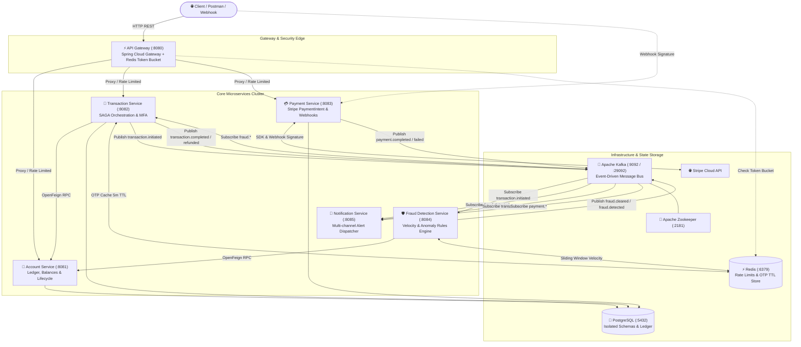
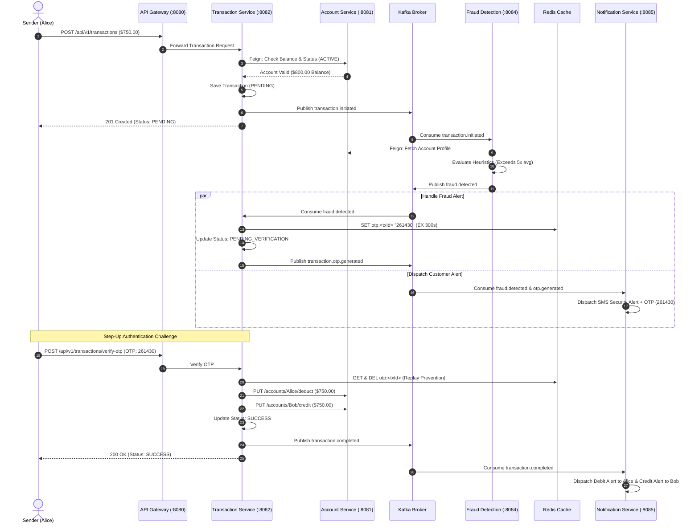

# Event-Driven Digital Banking Platform

[](https://openjdk.org/)
[](https://spring.io/projects/spring-boot)
[](https://spring.io/projects/spring-cloud)
[](https://kafka.apache.org/)
[](https://www.postgresql.org/)
[](https://redis.io/)
[](https://www.docker.com/)
[](https://stripe.com/)

An enterprise-grade, distributed digital banking microservices platform designed for high throughput, strict financial consistency, and real-time fraud mitigation. Built with **Java 21**, **Spring Boot 4**, **Apache Kafka**, **PostgreSQL**, **Redis**, and **Docker Compose**, this project demonstrates core distributed systems patterns including **Choreography-based SAGA**, **Risk-Based Authentication (RBA) Step-Up MFA**, **Token Bucket Rate Limiting**, and **Asynchronous Webhook Processing**.

---

## Table of Contents

- [System Architecture](#-system-architecture)
- [Key Engineering Highlights & Design Patterns](#-key-engineering-highlights--design-patterns)
  - [1. Distributed SAGA Orchestration (Event Choreography)](#1-distributed-saga-orchestration-event-choreography)
  - [2. Risk-Based Authentication (RBA) & Step-Up MFA](#2-risk-based-authentication-rba--step-up-mfa)
  - [3. Concurrency Control & Ledger Integrity](#3-concurrency-control--ledger-integrity)
  - [4. Distributed Rate Limiting via Token Bucket](#4-distributed-rate-limiting-via-token-bucket)
  - [5. Stripe Payment Gateway & Webhook Reconciliation](#5-stripe-payment-gateway--webhook-reconciliation)
- [Microservices Ecosystem](#-microservices-ecosystem)
- [Distributed Transaction Workflows](#-distributed-transaction-workflows)
- [API Reference](#-api-reference)
- [Getting Started & Local Deployment](#-getting-started--local-deployment)
- [End-to-End Verification Walkthrough](#-end-to-end-verification-walkthrough)

---

## System Architecture

The architecture consists of six decoupled microservices, fronted by a reactive API Gateway and coordinated through an Apache Kafka event backbone:



---

## Key Engineering Highlights & Design Patterns

### 1. Distributed SAGA Orchestration (Event Choreography)

- **Challenge**: Traditional two-phase commits (`2PC`) introduce distributed deadlocks and tight database coupling in microservices.
- **Solution**: Implemented an asynchronous **Choreography-based SAGA** across `transaction-service`, `fraud-detection-service`, and `account-service`.
- **Compensation**: If a destination credit or downstream validation fails after the sender account has already been debited, the SAGA immediately triggers a compensating transaction (`PUT /api/v1/accounts/{accountNumber}/refund`), restoring the sender's balance and publishing a `transaction.refunded` event for customer alerting.

### 2. Risk-Based Authentication (RBA) & Step-Up MFA

- **Challenge**: Static authentication either creates friction for all users or leaves high-value transfers vulnerable to account takeovers.
- **Solution**: Developed a multi-layered heuristic rule engine in `fraud-detection-service`:
  1. **Velocity Check**: Detects rapid-fire transfers via Redis sliding-window counter (`max-transaction-per-minute: 5`).
  2. **Historical Spike Analysis**: Flags transfers exceeding **5x** the customer's historical average amount.
  3. **Balance Drain Detection**: Flags any single transfer attempting to drain **> 90%** of available funds.
- **Adaptive Challenge**: Clean transfers settle immediately (<100ms). Suspicious transfers transition to `PENDING_VERIFICATION`, generating a cryptographically secure 6-digit OTP stored in Redis with a 5-minute TTL, while `notification-service` dispatches immediate security notices. The transfer settles only upon valid OTP submission (`POST /api/v1/transactions/verify-otp`).

### 3. Concurrency Control & Ledger Integrity

- **Double-Spending Prevention**: The balance debit and credit operations in `account-service` utilize JPA **Pessimistic Write Locking** (`@Lock(LockModeType.PESSIMISTIC_WRITE)`) at the SQL level (`SELECT ... FOR UPDATE`), eliminating race conditions during concurrent financial transfers.
- **Idempotency Safeguard**: Fund transfer requests require client-provided `idempotencyKey` values. Duplicate network submissions return the existing transaction record without re-executing ledger mutations.

### 4. Distributed Rate Limiting via Token Bucket

- Integrated **Spring Cloud Gateway** with **Redis** using the Reactive Token Bucket algorithm (`RequestRateLimiter`).
- Implemented client IP resolution (`@ipKeyResolver`) enforcing strict throughput limits (`replenishRate: 10 req/s`, `burstCapacity: 20 req/s`) to protect backend services from denial-of-service and brute-force traffic.

### 5. Stripe Payment Gateway & Webhook Reconciliation

- Built an end-to-end card deposit integration with **Stripe PaymentIntents**.
- Handled asynchronous fulfillment via `StripeWebhookController` with cryptographic signature verification (`Webhook.constructEvent(...)`) against timing attacks.
- Persisted payment states (`PENDING` -> `COMPLETED` / `FAILED`) and broadcast `payment.completed` to Kafka for ledger crediting and notification dispatch.

---

## Microservices Ecosystem

| Service                       |  Port  | Primary Responsibilities                                                             | Tech Stack / Dependencies                               |
| :---------------------------- | :----: | :----------------------------------------------------------------------------------- | :------------------------------------------------------ |
| **`api-gateway`**             | `8080` | Unified routing, token-bucket rate limiting, actuator health probes                  | Spring Cloud Gateway WebFlux, Reactive Redis            |
| **`account-service`**         | `8081` | Account lifecycle, balance queries, pessimistic ledger debit/credit, freeze/unfreeze | Spring Boot 4, Spring Data JPA, PostgreSQL, Hibernate   |
| **`transaction-service`**     | `8082` | Distributed SAGA coordinator, idempotency checks, step-up OTP challenge              | Spring Boot 4, Spring Data JPA, OpenFeign, Kafka, Redis |
| **`payment-service`**         | `8083` | Stripe PaymentIntent generation, webhook signature validation, payment queries       | Spring Boot 4, Stripe Java SDK, Kafka, PostgreSQL       |
| **`fraud-detection-service`** | `8084` | Real-time risk scoring (velocity, spike, drain checks), Kafka routing                | Spring Boot 4, Spring Kafka, OpenFeign, Redis           |
| **`notification-service`**    | `8085` | Multi-topic Kafka consumer, simulated SMS/Email alert dispatch                       | Spring Boot 4, Spring Kafka, Jackson 3 Type Inference   |

### Infrastructure Components

| Component        | Container Name |     Port(s)     | Role                                                                  |
| :--------------- | :------------- | :-------------: | :-------------------------------------------------------------------- |
| **PostgreSQL**   | `postgres`     |     `5432`      | Relational database with isolated schemas & persistent volume storage |
| **Redis**        | `redis`        |     `6379`      | In-memory store for rate limiting counters and 5-min OTP TTL keys     |
| **Apache Kafka** | `kafka`        | `9092`, `29092` | Distributed streaming platform for asynchronous SAGA & alert events   |
| **Zookeeper**    | `zookeeper`    |     `2181`      | Cluster coordination and metadata management for Kafka                |

---

## Distributed Transaction Workflows

### Fund Transfer SAGA & Risk-Based Step-Up Flow



---

## API Reference

All requests can be routed through the central **API Gateway** on port `8080`.

### 1. Account Service (`/api/v1/accounts`)

| Method | Endpoint                                   | Description                                |  Sample Status   |
| :----- | :----------------------------------------- | :----------------------------------------- | :--------------: |
| `POST` | `/api/v1/accounts`                         | Create new bank account                    |  `201 Created`   |
| `GET`  | `/api/v1/accounts/{accountNumber}`         | Retrieve account details & balance         |     `200 OK`     |
| `GET`  | `/api/v1/accounts/customer/{customerId}`   | List accounts for customer portfolio       |     `200 OK`     |
| `PUT`  | `/api/v1/accounts/{accountNumber}/block`   | Freeze account (blocks outgoing transfers) | `204 No Content` |
| `PUT`  | `/api/v1/accounts/{accountNumber}/unblock` | Restore account to `ACTIVE` standing       | `204 No Content` |
| `PUT`  | `/api/v1/accounts/{accountNumber}/deduct`  | SAGA: Deduct balance (Pessimistic Lock)    |     `200 OK`     |
| `PUT`  | `/api/v1/accounts/{accountNumber}/credit`  | SAGA: Credit balance                       |     `200 OK`     |
| `PUT`  | `/api/v1/accounts/{accountNumber}/refund`  | SAGA Compensation: Refund balance          |     `200 OK`     |

### 2. Transaction Service (`/api/v1/transactions`)

| Method | Endpoint                                       | Description                                    | Sample Status |
| :----- | :--------------------------------------------- | :--------------------------------------------- | :-----------: |
| `POST` | `/api/v1/transactions`                         | Initiate fund transfer (SAGA trigger)          | `201 Created` |
| `GET`  | `/api/v1/transactions/{id}`                    | Query single transaction state                 |   `200 OK`    |
| `GET`  | `/api/v1/transactions/account/{accountNumber}` | Retrieve account transaction history statement |   `200 OK`    |
| `POST` | `/api/v1/transactions/verify-otp`              | Submit step-up OTP to settle flagged transfer  |   `200 OK`    |

### 3. Payment Service (`/api/v1/payments`)

| Method | Endpoint                                       | Description                                   | Sample Status |
| :----- | :--------------------------------------------- | :-------------------------------------------- | :-----------: |
| `POST` | `/api/v1/payments/initiate`                    | Create Stripe `PaymentIntent`                 | `201 Created` |
| `POST` | `/api/v1/payments/webhook`                     | Stripe webhook listener (Signature verified)  |   `200 OK`    |
| `GET`  | `/api/v1/payments/{id}`                        | Query payment record by ID                    |   `200 OK`    |
| `GET`  | `/api/v1/payments/transaction/{transactionId}` | Reconcile payment via internal transaction ID |   `200 OK`    |

---

## Getting Started & Local Deployment

### Prerequisites

- [Docker & Docker Compose](https://www.docker.com/) (Docker Desktop on Windows/macOS/Linux)
- [Java 21 JDK](https://adoptium.net/) & [Maven 3.9+](https://maven.apache.org/) (optional if running pre-built images)
- [Stripe CLI](https://stripe.com/docs/stripe-cli) (optional, for local webhook forwarding)

### 1. Clone & Configure Environment

```bash
git clone https://github.com/your-username/digital-banking-system.git
cd digital-banking-system
cp .env.example .env
```

_(Add your Stripe API Key and Webhook Secret in `.env` if testing card deposits)._

### 2. Build Microservice JARs

```bash
# Package all microservices
mvn clean package -DskipTests
```

### 3. Launch Entire 10-Container Cluster

```bash
docker-compose up --build -d
```

### 4. Verify Cluster Health

Check container status:

```bash
docker-compose ps
```

Probe the unified API Gateway health actuator:

```bash
curl http://localhost:8080/actuator/health
```

**Response**:

```json
{
  "status": "UP",
  "components": {
    "redis": { "status": "UP", "details": { "version": "8.10.3" } },
    "diskSpace": { "status": "UP" },
    "livenessState": { "status": "UP" },
    "readinessState": { "status": "UP" }
  }
}
```

---

## End-to-End Verification Walkthrough

Follow these steps using `curl` (or Postman) to test the platform through the gateway:

### Step 1: Create Sender (Alice) and Receiver (Bob)

```bash
# Create Alice with $1000 initial balance
curl -X POST http://localhost:8080/api/v1/accounts \
  -H "Content-Type: application/json" \
  -d '{
    "accountHolderName": "Alice Sender",
    "email": "alice@example.com",
    "phone": "+1234567890",
    "initialDeposit": 1000.00,
    "currency": "USD",
    "type": "SAVINGS"
  }'

# Create Bob with $200 initial balance
curl -X POST http://localhost:8080/api/v1/accounts \
  -H "Content-Type: application/json" \
  -d '{
    "accountHolderName": "Bob Receiver",
    "email": "bob@example.com",
    "phone": "+1987654321",
    "initialDeposit": 200.00,
    "currency": "USD",
    "type": "SAVINGS"
  }'
```

### Step 2: Execute Clean Peer-to-Peer Transfer ($100.00)

```bash
curl -X POST http://localhost:8080/api/v1/transactions \
  -H "Content-Type: application/json" \
  -d '{
    "sourceAccountNumber": "<ALICE_ACCOUNT_NUMBER>",
    "targetAccountNumber": "<BOB_ACCOUNT_NUMBER>",
    "amount": 100.00,
    "currency": "USD",
    "description": "Lunch reimbursement",
    "idempotencyKey": "txn-clean-001"
  }'
```

_Flow_: Initiated → Fraud Check Cleared → Balance Deducted & Credited (<100ms) → Alerts Dispatched.

### Step 3: Trigger Fraud Detection & Step-Up MFA Challenge ($750.00)

```bash
# Alice transfers $750.00 (>90% of her remaining $900 balance)
curl -X POST http://localhost:8080/api/v1/transactions \
  -H "Content-Type: application/json" \
  -d '{
    "sourceAccountNumber": "<ALICE_ACCOUNT_NUMBER>",
    "targetAccountNumber": "<BOB_ACCOUNT_NUMBER>",
    "amount": 750.00,
    "currency": "USD",
    "description": "High value transfer",
    "idempotencyKey": "txn-fraud-001"
  }'
```

_Response_: `"status": "PENDING"`.  
Inspect `transaction-service` logs to see the generated OTP:

```bash
docker-compose logs --tail=20 transaction-service
# Log: Step-Up Challenge: Generated OTP for flagged transaction <TX_ID>: 261430
```

### Step 4: Authorize and Settle Transfer with OTP

```bash
curl -X POST http://localhost:8080/api/v1/transactions/verify-otp \
  -H "Content-Type: application/json" \
  -d '{
    "transactionId": "<TX_ID>",
    "otp": "261430"
  }'
```

_Result_: Transfer transitions to `SUCCESS`. Alice balance drops to `$50.00`, Bob balance becomes `$1,050.00`.

### Step 5: Test Security Freeze / Block

```bash
# Freeze Alice's account
curl -X PUT http://localhost:8080/api/v1/accounts/<ALICE_ACCOUNT_NUMBER>/block

# Attempt transfer while frozen -> Returns 400 Bad Request ("Source or target account is not active")
curl -X POST http://localhost:8080/api/v1/transactions \
  -H "Content-Type: application/json" \
  -d '{
    "sourceAccountNumber": "<ALICE_ACCOUNT_NUMBER>",
    "targetAccountNumber": "<BOB_ACCOUNT_NUMBER>",
    "amount": 10.00,
    "currency": "USD",
    "description": "Blocked test"
  }'

# Unfreeze account
curl -X PUT http://localhost:8080/api/v1/accounts/<ALICE_ACCOUNT_NUMBER>/unblock
```
