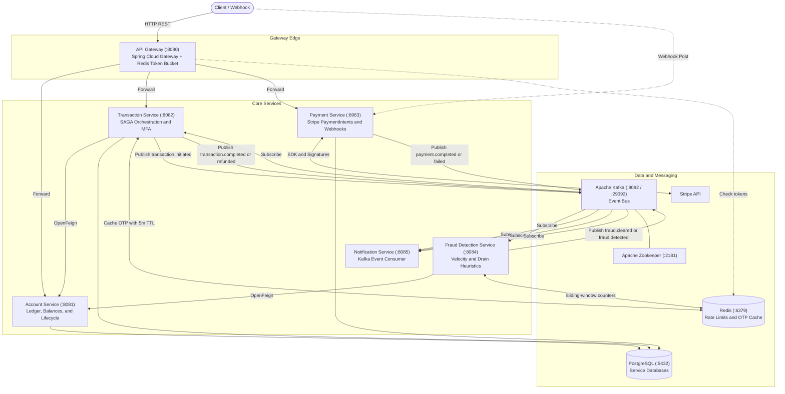
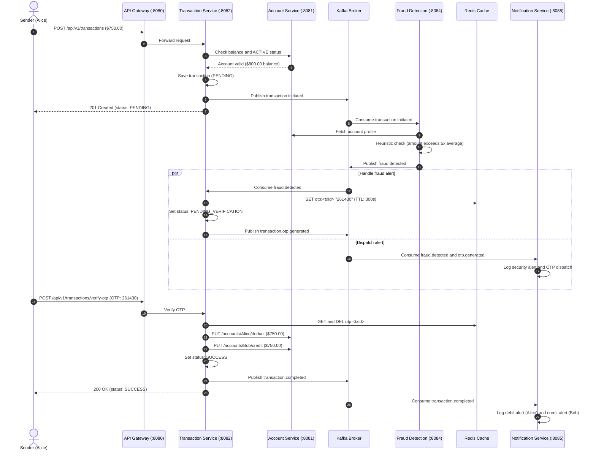

# Event-Driven Digital Banking Platform

[](https://openjdk.org/)
[](https://spring.io/projects/spring-boot)
[](https://spring.io/projects/spring-cloud)
[](https://kafka.apache.org/)
[](https://www.postgresql.org/)
[](https://redis.io/)
[](https://www.docker.com/)
[](https://stripe.com/)

A distributed banking backend built with Java 21, Spring Boot 4, Apache Kafka, PostgreSQL, and Redis. It handles account management, peer-to-peer transfers, Stripe card deposits, and automated fraud checks across six containerized services.

---

## Table of Contents

- [System Architecture](#system-architecture)
- [Design Decisions](#design-decisions)
  - [Distributed SAGA and Compensation](#distributed-saga-and-compensation)
  - [Risk-Based Authentication and Step-Up MFA](#risk-based-authentication-and-step-up-mfa)
  - [Concurrency Control and Idempotency](#concurrency-control-and-idempotency)
  - [Rate Limiting](#rate-limiting)
  - [Stripe Webhook Processing](#stripe-webhook-processing)
- [Microservices Ecosystem](#microservices-ecosystem)
- [Transaction Flow](#transaction-flow)
- [API Reference](#api-reference)
- [Local Deployment](#local-deployment)
- [End-to-End Verification](#end-to-end-verification)

---

## System Architecture

Six Spring Boot services run behind an API gateway, communicating synchronously through OpenFeign where immediate state checks are required and asynchronously through Kafka topics for events.



---

## Design Decisions

### Distributed SAGA and Compensation

Instead of distributed transactions (2PC), which lock database rows across services and degrade availability, fund transfers run as an orchestrated SAGA across `transaction-service`, `fraud-detection-service`, and `account-service`.

1. `transaction-service` creates a transfer record in `PENDING` state and emits `transaction.initiated`.
2. `fraud-detection-service` runs heuristic checks. If clean, it emits `fraud.cleared`.
3. `transaction-service` debits the sender via `PUT /api/v1/accounts/{accountNumber}/deduct`.
4. `transaction-service` credits the recipient via `PUT /api/v1/accounts/{accountNumber}/credit`.
5. If the credit step fails (network drop, recipient account closed), `transaction-service` executes a compensating refund (`PUT /api/v1/accounts/{accountNumber}/refund`), marks the transaction `REFUNDED`, and emits `transaction.refunded` so `notification-service` alerts the customer.

### Risk-Based Authentication and Step-Up MFA

Rather than challenging every transfer with multi-factor authentication, `fraud-detection-service` evaluates risk on each `transaction.initiated` event:

- **Velocity check**: Uses Redis `INCR` with a 60-second sliding TTL to detect bursts over 5 transactions per minute.
- **Historical average check**: Compares amount against customer history stored in Redis, flagging amounts over 5 times the running average.
- **Balance drain check**: Flags any transfer exceeding 90% of available account balance.

When flagged, the service emits `fraud.detected`. `transaction-service` holds the transfer in `PENDING_VERIFICATION`, generates a 6-digit OTP stored in Redis with a 5-minute TTL, and requests an SMS dispatch from `notification-service`. Funds do not move until the user submits the correct OTP via `POST /api/v1/transactions/verify-otp`.

### Concurrency Control and Idempotency

- **Pessimistic locking**: `account-service` uses JPA pessimistic write locks (`@Lock(LockModeType.PESSIMISTIC_WRITE)` mapping to `SELECT ... FOR UPDATE`) during balance deductions and credits. This serializes operations on the same account row, preventing negative balances and race conditions under concurrent requests.
- **Idempotency keys**: `POST /api/v1/transactions` accepts an `idempotencyKey` header or payload field. Duplicate network submissions return the existing transaction record rather than executing a duplicate transfer.

### Rate Limiting

`api-gateway` enforces rate limits using Spring Cloud Gateway's reactive Redis token bucket filter (`RequestRateLimiter`). Traffic is keyed by remote IP (`ipKeyResolver`):

- Account and transaction routes allow 10 requests per second with a burst capacity of 20.
- Payment routes allow 5 requests per second with a burst capacity of 10.
- Requests exceeding the bucket limit return HTTP `429 Too Many Requests`.

### Stripe Webhook Processing

Card deposits run through Stripe's PaymentIntent API. `payment-service` initiates the intent and returns a `client_secret` to the client.

Final payment status is received via `POST /api/v1/payments/webhook`. The controller verifies the `Stripe-Signature` header using `Webhook.constructEvent(...)` with the configured webhook secret, protecting against forged events and timing attacks. Verified events update the payment record to `COMPLETED` and publish `payment.completed` to Kafka.

---

## Microservices Ecosystem

| Service                   |  Port  | Responsibilities                                                                  | Key Dependencies                         |
| :------------------------ | :----: | :-------------------------------------------------------------------------------- | :--------------------------------------- |
| `api-gateway`             | `8080` | Reverse proxy routing, rate limiting, actuator health probes                      | Spring Cloud Gateway WebFlux, Redis      |
| `account-service`         | `8081` | Account records, balance queries, pessimistic debits and credits, freeze/unfreeze | Spring Data JPA, PostgreSQL, Hibernate   |
| `transaction-service`     | `8082` | Transfer SAGA orchestration, idempotency checks, step-up OTP challenge            | Spring Data JPA, OpenFeign, Kafka, Redis |
| `payment-service`         | `8083` | Stripe PaymentIntent generation, webhook signature validation, payment records    | Stripe Java SDK, Kafka, PostgreSQL       |
| `fraud-detection-service` | `8084` | Heuristic evaluation (velocity, spike, drain), risk event routing                 | Spring Kafka, OpenFeign, Redis           |
| `notification-service`    | `8085` | Multi-topic Kafka consumer, SMS and email alert dispatch logging                  | Spring Kafka, Jackson 3                  |

### Infrastructure

| Container   | Image                             |        Ports         | Purpose                                                     |
| :---------- | :-------------------------------- | :------------------: | :---------------------------------------------------------- |
| `postgres`  | `postgres:latest`                 |     `5432:5432`      | Relational storage for accounts, transactions, and payments |
| `redis`     | `redis:latest`                    |     `6379:6379`      | Token bucket rate limits and 5-minute OTP cache             |
| `kafka`     | `confluentinc/cp-kafka:7.5.0`     | `9092:9092`, `29092` | Event messaging between services                            |
| `zookeeper` | `confluentinc/cp-zookeeper:7.5.0` |     `2181:2181`      | Kafka cluster coordination                                  |

---

## Transaction Flow



---

## API Reference

All requests route through the gateway on port `8080`.

### Account Service (`/api/v1/accounts`)

| Method | Endpoint                                   | Description                                  |      Status      |
| :----- | :----------------------------------------- | :------------------------------------------- | :--------------: |
| `POST` | `/api/v1/accounts`                         | Create account                               |  `201 Created`   |
| `GET`  | `/api/v1/accounts/{accountNumber}`         | Get account details and balance              |     `200 OK`     |
| `GET`  | `/api/v1/accounts/customer/{customerId}`   | List accounts for customer                   |     `200 OK`     |
| `PUT`  | `/api/v1/accounts/{accountNumber}/block`   | Freeze account (blocks outgoing transfers)   | `204 No Content` |
| `PUT`  | `/api/v1/accounts/{accountNumber}/unblock` | Restore account to `ACTIVE`                  | `204 No Content` |
| `PUT`  | `/api/v1/accounts/{accountNumber}/deduct`  | SAGA step: Deduct balance (pessimistic lock) |     `200 OK`     |
| `PUT`  | `/api/v1/accounts/{accountNumber}/credit`  | SAGA step: Credit balance                    |     `200 OK`     |
| `PUT`  | `/api/v1/accounts/{accountNumber}/refund`  | SAGA compensation: Refund balance            |     `200 OK`     |

### Transaction Service (`/api/v1/transactions`)

| Method | Endpoint                                       | Description                           |    Status     |
| :----- | :--------------------------------------------- | :------------------------------------ | :-----------: |
| `POST` | `/api/v1/transactions`                         | Initiate transfer                     | `201 Created` |
| `GET`  | `/api/v1/transactions/{id}`                    | Get transaction by ID                 |   `200 OK`    |
| `GET`  | `/api/v1/transactions/account/{accountNumber}` | List transaction history for account  |   `200 OK`    |
| `POST` | `/api/v1/transactions/verify-otp`              | Submit step-up OTP to settle transfer |   `200 OK`    |

### Payment Service (`/api/v1/payments`)

| Method | Endpoint                                       | Description                                  |    Status     |
| :----- | :--------------------------------------------- | :------------------------------------------- | :-----------: |
| `POST` | `/api/v1/payments/initiate`                    | Create Stripe `PaymentIntent`                | `201 Created` |
| `POST` | `/api/v1/payments/webhook`                     | Stripe webhook endpoint (signature verified) |   `200 OK`    |
| `GET`  | `/api/v1/payments/{id}`                        | Get payment by ID                            |   `200 OK`    |
| `GET`  | `/api/v1/payments/transaction/{transactionId}` | Get payment by transaction ID                |   `200 OK`    |

---

## Local Deployment

### Prerequisites

- Docker and Docker Compose
- Java 21 JDK and Maven 3.9+ (for building JAR files)
- Stripe account keys (optional, needed only for card deposit tests)

### 1. Build Service Packages

```bash
mvn clean package -DskipTests
```

### 2. Configure Environment

Create a `.env` file in the project root:

```env
STRIPE_API_KEY=sk_test_your_key_here
STRIPE_WEBHOOK_SECRET=whsec_your_secret_here
```

### 3. Start Containers

```bash
docker-compose up --build -d
```

### 4. Verify Gateway Health

```bash
curl http://localhost:8080/actuator/health
```

Expected output:

```json
{
  "status": "UP",
  "components": {
    "redis": { "status": "UP", "details": { "version": "8.10.3" } },
    "diskSpace": { "status": "UP" },
    "livenessState": { "status": "UP" },
    "readinessState": { "status": "UP" }
  }
}
```

---

## End-to-End Verification

### 1. Create Sender and Receiver Accounts

```bash
# Create Alice ($1000 balance)
curl -X POST http://localhost:8080/api/v1/accounts \
  -H "Content-Type: application/json" \
  -d '{
    "accountHolderName": "Alice Sender",
    "email": "alice@example.com",
    "phone": "+1234567890",
    "initialDeposit": 1000.00,
    "currency": "USD",
    "type": "SAVINGS"
  }'

# Create Bob ($200 balance)
curl -X POST http://localhost:8080/api/v1/accounts \
  -H "Content-Type: application/json" \
  -d '{
    "accountHolderName": "Bob Receiver",
    "email": "bob@example.com",
    "phone": "+1987654321",
    "initialDeposit": 200.00,
    "currency": "USD",
    "type": "SAVINGS"
  }'
```

### 2. Standard Transfer ($100.00)

```bash
curl -X POST http://localhost:8080/api/v1/transactions \
  -H "Content-Type: application/json" \
  -d '{
    "sourceAccountNumber": "<ALICE_ACCOUNT_NUMBER>",
    "targetAccountNumber": "<BOB_ACCOUNT_NUMBER>",
    "amount": 100.00,
    "currency": "USD",
    "description": "Lunch transfer",
    "idempotencyKey": "txn-001"
  }'
```

The transfer is evaluated as low risk, debits Alice, credits Bob, and completes within 100 ms.

### 3. High-Risk Transfer and Step-Up MFA Challenge ($750.00)

```bash
curl -X POST http://localhost:8080/api/v1/transactions \
  -H "Content-Type: application/json" \
  -d '{
    "sourceAccountNumber": "<ALICE_ACCOUNT_NUMBER>",
    "targetAccountNumber": "<BOB_ACCOUNT_NUMBER>",
    "amount": 750.00,
    "currency": "USD",
    "description": "Large transfer",
    "idempotencyKey": "txn-002"
  }'
```

Because the amount exceeds 5 times the running average and drains over 90% of Alice's remaining balance, the transaction returns status `PENDING` and moves to `PENDING_VERIFICATION` in the background.

Retrieve the generated OTP from `transaction-service` logs:

```bash
docker-compose logs --tail=20 transaction-service
# Finds log: Step-Up Challenge: Generated OTP for flagged transaction <TX_ID>: 261430
```

### 4. Settle Flagged Transfer with OTP

```bash
curl -X POST http://localhost:8080/api/v1/transactions/verify-otp \
  -H "Content-Type: application/json" \
  -d '{
    "transactionId": "<TX_ID>",
    "otp": "261430"
  }'
```

Response returns status `SUCCESS`. Alice balance drops to `$50.00`, and Bob balance updates to `$1,050.00`.

### 5. Account Freeze and Transfer Block

```bash
# Freeze Alice's account
curl -X PUT http://localhost:8080/api/v1/accounts/<ALICE_ACCOUNT_NUMBER>/block

# Attempt transfer while frozen (returns 400 Bad Request)
curl -X POST http://localhost:8080/api/v1/transactions \
  -H "Content-Type: application/json" \
  -d '{
    "sourceAccountNumber": "<ALICE_ACCOUNT_NUMBER>",
    "targetAccountNumber": "<BOB_ACCOUNT_NUMBER>",
    "amount": 10.00,
    "currency": "USD",
    "description": "Frozen test"
  }'

# Unfreeze account
curl -X PUT http://localhost:8080/api/v1/accounts/<ALICE_ACCOUNT_NUMBER>/unblock
```
